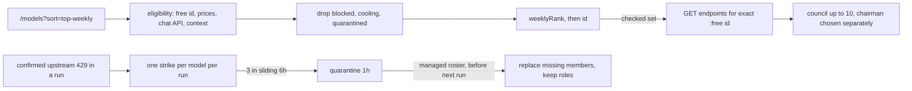

# Healthy Top 10 Free

## Цель и критерии готовности

Исходная цель — сократить предсказуемые провалы бесплатных запросов и
не возвращать постоянно сбоящую модель в управляемый состав.

Рейтинг качества моделей и оптимальное число участников — отдельные
измеряемые вопросы. Название Top 10 означает верхнюю границу пресета,
а не доказанную оптимальность десяти участников.

R1. Пресет выбирает только допустимые бесплатные маршруты и не включает
модели с действующим блокированием, cooldown или карантином.

R2. Отсутствующие метаданные не превращаются в нулевую оценку качества
или доказательство недоступности.

R3. Повторные подтверждённые upstream 429 приводят к временному исключению;
общие ограничения аккаунта не вызывают перебор моделей.

R4. Автозамена действует только при явном управлении пресетом.
Состав начатого запуска остаётся неизменным.

R5. Первые измерения не зависят от готовности карантина, истории замен
и законченного интерфейса.

R6. Существующий frozen eval не получает новые фильтры, карантин
или автоматические замены.

## Что проверено по коду и API

- `rankTopFreeModels` в [frontend/src/engine/browser/roster.js](frontend/src/engine/browser/roster.js) ранжирует по размеру из `publishedModelSize` (разбор `\d+[bt]` из id, name и description), исключает только `blockedIds` (harness-only 403) и `SPECIALIZED_FREE` (`code|coder|codestral|devstral|starcoder|safety|guard|omni|-fin|-sante`). Кулдауны при ранжировании игнорируются (тест «does not exclude a model that is cooling down»).
- `loadModelsPricing` в [frontend/src/engine/browser/openrouter.js](frontend/src/engine/browser/openrouter.js) запрашивает `/api/v1/models` без сортировки и хранит только `name`, `pricing`, `description`; `modelsFromPricing` в [frontend/src/engine/browser/engine.js](frontend/src/engine/browser/engine.js) ещё раз режет поля и сортирует по имени.
- Стадии читают настройки каждая сама: Stage 1 `settings.councilModels` (council.js 430), Stage 2 (479), red team `settings.redTeamModel || settings.chairmanModel` (630), синтез `synthesisCandidates()` (878–879).
- `settings.writeRoster` обнуляет `red_team_model`, если `pruned.redTeamModel` не передан (settings.js 236–246). `use_free_tier_default` одноразовый: `writeFreeTierDefaults` сразу ставит его в `false`.
- Endpoint API принимает точный id с `:free`: `/api/v1/models/{author}/{slug}:free/endpoints`. `canonical_slug` может не содержать `:free`, для запросов он не годится.
- Xingchen в момент проверки: `status: 0`, uptime 100% за 5 и 30 минут. Глобальный uptime его не отсеет; нужен локальный учёт повторных upstream 429.
- `/models?sort=top-weekly` и `sort=most-popular` отвечают 200. `top-weekly` — объём токенов за неделю, не число запросов и не качество.
- В снимке каталога 14 моделей с `:free`, `benchmarks.artificial_analysis.intelligence` есть у 5.
- Eval: [frontend/eval/transport.js](frontend/eval/transport.js) разрешает GET только по `pathname`, поэтому `?sort=top-weekly` для него прозрачен; [frontend/eval/protocol.js](frontend/eval/protocol.js) фиксирует «a roster mutation stops the cohort; the model is not replaced».

## 1. Правило выбора

### Пригодность

Для каждого кандидата проверить:

- Точный catalogue id заканчивается на `:free`.
- Известные цены входа, выхода и применимых дополнительных компонентов
  (`pricing.request`, `pricing.image`, `internal_reasoning`, `web_search`
  при наличии) равны нулю. `max_price=0` фильтрует только вход и не заменяет
  эту проверку.
- Поддерживаются используемый chat API и текстовые модальности на входе и выходе.
- Контекст и предел ответа подходят для назначаемой роли.
- Нет действующего blocked/cooldown/quarantine.

Не заменять `id` на `canonical_slug` при отправке запроса.
Локальные reasoning-варианты одной модели (`-reasoning`, `-reasoning-high`)
не считаются независимыми участниками совета.

`SPECIALIZED_FREE` сузить до явного служебного назначения (safety/guard).
Подстроки `code`, `coder`, `omni` и подобные сами по себе не доказывают
непригодность для общих задач. Не строить автоматическую классификацию
специализаций в рамках этой задачи.

### Первоначальное ранжирование

При отсутствии сопоставимых собственных измерений:

1. Допустимые кандидаты без известных препятствий.
2. Сохранённый `weeklyRank` из `/models?sort=top-weekly`.
3. Стабильный `id` для воспроизводимого fallback.

Это начальная гипотеза, а не утверждение о превосходстве популярных моделей.
Популярность может отражать цену, приложения с большим трафиком
и длину генерируемых ответов.

Размер модели не использовать как основной показатель качества.
Не извлекать его из случайного упоминания другой модели в description.

Если недельный порядок получить не удалось, явно отметить fallback
на прежнее ранжирование. Алфавитный порядок UI не должен становиться
незаметной заменой рейтинга.

### Benchmark-оценки

Внешние intelligence/coding/agentic scores хранить отдельно,
с указанием источника и отсутствующих значений.

Не складывать их с uptime и популярностью в произвольный общий балл.
Не сортировать все модели с известным score выше всех моделей без score:
при текущем покрытии это преимущественно отбор по наличию измерений.

Для общего пресета coding score не заменяет оценку общих задач.

Собственные результаты могут стать основным критерием только при
сопоставимых заданиях, конфигурациях и бюджетах. Текущий показатель
`correct / attempts` уже учитывает неуспешные попытки; повторно умножать
его на completion rate не нужно.

Held-out test и результаты paid repair/повторных розыгрышей не использовать
для подбора состава или доказательства доступности бесплатного маршрута.

### Разнообразие

В первой версии убрать только доказуемые дубли конфигураций.

Не вводить жёсткое правило «один автор — одна модель».
Автор, хостинг-провайдер и семейство модели — разные понятия.

Не обещать разнообразие ошибок по различающимся названиям.
Позже его можно оценить по ответам на одинаковые dev-вопросы.
Это не зависимость первого выпуска.

### Председатель

Выбирать отдельно среди пригодных участников с достаточным контекстом
для синтеза ответов совета.

При отсутствии собственного сравнения допустимо выбрать участника
с максимальным известным intelligence score; явно считать это внешним
ориентиром среди оценённых кандидатов, а не доказательством лучшего синтеза.
Если сопоставимых оценок нет — использовать недельный порядок.

`reasoning-high` назначать только при подтверждённой поддержке
(`reasoning.supported_efforts` содержит `high`; отсутствие поля и `null`
различать). Иначе использовать допустимую конфигурацию по умолчанию.
Наличие поддержки high само по себе не доказывает, что этот режим
лучше при текущем лимите токенов и времени.

## 2. Первое измерение — до постоянной инфраструктуры

На одном снимке каталога построить:

- A: текущий пресет по размеру;
- B: предлагаемый порядок после проверки пригодности и известных препятствий.

Сохранить причины различий между составами.

Выполнить один одинаковый короткий запрос на модель из объединения A и B:
не более 20 inference POST, без скрытых retry и платного fallback.
Общие участники проверяются один раз.

Реализация: отдельный Node-скрипт `frontend/scripts/free-roster-smoke.mjs`,
который переиспользует `installTransport` из [frontend/eval/transport.js](frontend/eval/transport.js)
(`allowPaid: false`, allowlist из объединения A и B, журнал каждого POST)
и пишет результат в gitignored `frontend/eval/.runs/free-smoke/`.
Ключ только через `or_key` из окружения; ключ, текст ответов и id вопросов
в консоль не выводить. Протокол eval, `select.js` и `protocolDocument()`
не трогать.

Учитывать фактический доступный лимит аккаунта (`/key`). При общем ограничении
остановить измерение, а не записывать всем оставшимся моделям failures.

Зафиксировать:

- закончен ли непустой ответ;
- время выполнения;
- HTTP, JSON или SSE ошибка;
- установлен ли источник 429 (`limit_source`, `provider_name`, `is_byok`);
- какой статус и uptime были перед запросом.

Это smoke доступности, а не проверка точности, устойчивости или большого
контекста. Один успех не доказывает надёжность.

Существующие измерения качества продолжать по их протоколу.
Сравнение новых составов проводить отдельным заранее фиксированным
экспериментом, без изменения текущего cohort.

## 3. Сохранение API-данных

Файлы:

- [frontend/src/engine/browser/openrouter.js](frontend/src/engine/browser/openrouter.js)
- [frontend/src/engine/browser/engine.js](frontend/src/engine/browser/engine.js)

`loadModelsPricing` запрашивает `/models?sort=top-weekly` и сохраняет
на каждую модель: `weeklyRank` (позиция в ответе), `pricing` целиком,
`context_length`, `architecture.input_modalities` / `output_modalities`,
`supported_parameters`, `top_provider.max_completion_tokens`,
`reasoning` (как есть, с различием «нет поля» / `null` / массив),
`benchmarks` (nullable, без преобразования `null` в 0).

`modelsFromPricing` пропускает эти поля дальше и продолжает сортировать
по имени только для UI. Не заменять общий каталог приложения free-only
запросом: платные модели должны остаться доступны в настройках.

Если дополнительные поля пропали, базовый каталог (name, pricing,
description) продолжает работать. Кэш и cooldown каталога не меняются.

Готовность: fixture проходит весь путь от API до selector без потери
порядка и метаданных; UI сохраняет свою независимую сортировку.

## 4. Проверка endpoints

Новый [frontend/src/engine/browser/freeRoster.js](frontend/src/engine/browser/freeRoster.js)
оркестрирует запросы. roster.js содержит чистые правила и не импортирует
openrouter.js (это уже зафиксировано в его заголовке).

Запрашивать endpoints точного `:free` id.
Проверять цену, совместимость и состояние на одном endpoint;
нельзя объединять подходящий контекст одного провайдера с uptime другого.

Наличие подходящего endpoint означает потенциальную совместимость.
Обязательные параметры должны обеспечиваться фактической маршрутизацией
запроса; одно чтение каталога этого не гарантирует.

Состояния проверки:

- available: есть подходящий endpoint без известного запрета;
- unavailable: подтверждено отсутствие допустимого рабочего маршрута;
- unknown: запрос не удался, ответ неполон или статус не распознан.

Не считать сетевой сбой проверки отказом самой модели.
Неизвестный числовой status не интерпретировать автоматически.

В первом выпуске uptime сохранять для диагностики.
Пороги 90% за сутки и 80% за 30 минут не вводить как доказанные границы.
Особенно не исключать восстановившуюся модель только из-за старого
суточного провала.

Если измерения обоснуют отдельный uptime-фильтр, добавить его следующим
небольшим изменением с явной политикой неизвестных значений.

Ограничить работу: максимум 5 GET одновременно, 4 секунды на запрос,
8 секунд на всю операцию выбора. Кэш успешных проверок — 10 минут;
сбой проверки не кэшировать как unavailable. `Authorization: Bearer`
только при наличии `settings.apiKey`; без ключа uptime может быть `null`,
это состояние unknown, а не отказ.

Не выбирать кандидата за пределами проверенного набора с пометкой healthy.
Unchecked и unknown должны оставаться различимыми в диагностике.

Отмена пользователем отменяет операцию, а не запускает применение fallback.

## 5. Пресет и настройки

Файлы:

- [frontend/src/components/Settings.jsx](frontend/src/components/Settings.jsx)
- [frontend/src/engine/browser/settings.js](frontend/src/engine/browser/settings.js)
- [frontend/src/engine/browser/engine.js](frontend/src/engine/browser/engine.js)

Кнопка Top 10 Free (`selectTopFreeModels`) и автоматический дефолт
(`settleFreeTierDefaults` → `applyFreeTierDefaultRoster`) используют один
асинхронный selector из freeRoster.js. `applyFreeTierDefaultRoster`
переезжает в freeRoster.js и становится `async`; импорты в engine.js,
roster.test.js и engine.test.js обновить.

Кнопка получает состояние проверки. Результат применяется только если
операция всё ещё актуальна (`loadGeneration` / `formDirty` по образцу
`applyLoadedModels`) и пользователь не изменил состав за время GET.

Кнопка изменяет черновик настроек; сохранение следует существующему
поведению Settings.

Добавить отдельный `free_roster_managed`:
одноразовый `use_free_tier_default` не заменяет этот признак.

При явном сохранении пресета включать управление.
При ручном изменении совета или председателя отключать его —
там же, где `updateFromDict` сбрасывает `use_free_tier_default`.
Не выводить управление из того, что все выбранные модели бесплатные.

Показывать действительные причины:
cooldown, quarantine, неподходящий маршрут, unknown health.
Не писать «low uptime», если модель исключена по другой причине.

Не добавлять обязательную историю замен до проверки основного поведения.

## 6. Ошибки и карантин

Файлы:

- [frontend/src/engine/browser/openrouter.js](frontend/src/engine/browser/openrouter.js)
- [frontend/src/engine/browser/roster.js](frontend/src/engine/browser/roster.js)

Нормализовать HTTP, JSON и SSE ошибки с сохранением метаданных
(`error.metadata.raw`, `provider_name`, `limit_source`, `is_byok`).
HTTP 200 не считать доказательством успешного ответа.

Разделять:

- подтверждённый upstream rate limit (`limit_source` вида
  `upstream_provider_shared_pool` или текст `temporarily rate-limited upstream`);
- общий лимит аккаунта или бесплатных запросов (`free-models-per-min`,
  дневной лимит — уже отдельная ветка в `runModelAttempt`);
- неизвестное происхождение 429;
- сетевые и протокольные ошибки.

Одного `error_type = rate_limit_exceeded` недостаточно для установления
источника ограничения. Существующий `isUpstreamLimited` по подстроке
`provider returned error` слишком широк для страйка: страйк только при
подтверждённом upstream-источнике, cooldown как сейчас.

Один пользовательский запуск даёт не более одного strike на catalogue id.
Повторы события, внутренние retry и разные стадии того же запуска
не должны искусственно достигать порога. Для этого `runId` из снимка
запуска (п. 7) передаётся через `options` в `queryModelResult`,
инцидент хранится как `{ cid, at, runId }` и дедуплицируется по `runId`.

Начальная политика: 3 независимых подтверждённых инцидента за скользящие
6 часов → карантин на 1 час. Это настраиваемая исходная гипотеза,
а не измеренный оптимум. Хранилище localStorage
`llm-council-upstream-incidents`; `modelUnavailable` учитывает карантин.

Хранить временные отметки для настоящего скользящего окна.
После истечения карантина начинать новый период наблюдений.
Семидневный карантин не вводить без данных о длительности отказов.

Неизвестный 429 получает backoff, но не длительный model quarantine.
Общий лимит аккаунта не должен вызывать каскад замен.

Обработчик ошибки регистрирует событие.
Он не меняет `council_models` и роли.

## 7. Снимок запуска и управляемая замена

Файлы:

- [frontend/src/engine/browser/freeRoster.js](frontend/src/engine/browser/freeRoster.js) — новый
- [frontend/src/engine/browser/engine.js](frontend/src/engine/browser/engine.js)
- [frontend/src/engine/browser/council.js](frontend/src/engine/browser/council.js)
- [frontend/src/engine/browser/settings.js](frontend/src/engine/browser/settings.js)

Сначала обеспечить единый `runRoster` (`{ runId, councilModels,
chairmanModel, redTeamModel, nSamples, topK, selfExclusion }`) для Stage 1,
Stage 2, red team и synthesis. Сейчас каждая стадия перечитывает settings
(council.js 430, 479, 630, 878–879). Параметр `roster` в опциях стадий
необязателен и по умолчанию берётся из settings, чтобы вызовы из
[frontend/eval/variants.js](frontend/eval/variants.js) и существующие тесты
остались без изменений.

Перед новым пользовательским запуском (в `ensureServableRoster`):

1. Проверить, что состав всё ещё управляется пресетом.
2. Сохранить пригодных текущих участников.
3. Для недоступных участников (blocked, quarantine, cooling) подобрать
   допустимых кандидатов вне текущего состава по правилу п. 1 и проверке п. 4.
4. Сохранить позиции и неповреждённые роли.
5. Если выбыл председатель, повторить правило выбора председателя.
6. Проверить актуальность настроек и сохранить изменение
   (`writeRoster` с явным `redTeamModel`, иначе red team обнулится).
7. Создать неизменяемый снимок запуска.

Не менять состав из-за нового `weeklyRank` при каждом сообщении.
Популярность используется при выборе и замене, а не для постоянной ротации.

При отсутствии замены вернуть честный частичный состав и причину;
не добавлять платную, заблокированную или дублирующую модель ради числа 10.

Автоматическое восстановление не подключать к retry уже начатого запуска.
Проверить два параллельных разговора: замена для нового запуска
не меняет стадии другого.

## 8. Проверки и документация

Тесты добавлять рядом с соответствующими изменениями
(roster.test.js, openrouter.test.js, engine.test.js, новый freeRoster.test.js).

Обязательные сценарии:

- `weeklyRank` сохраняется через оба преобразования каталога;
- `null` benchmark не превращается в нулевую оценку;
- отсутствие reasoning effort отличается от `null` и массива;
- `:free` сохраняется во всех сетевых запросах;
- endpoint-проверка не смешивает свойства разных провайдеров;
- timeout и отмена имеют различное поведение;
- один 429 не учитывается несколько раз через HTTP/JSON/SSE и стадии одного `runId`;
- общий лимит (`free-models-per-min`, дневной) не карантинит модели;
- ручной состав не заменяется;
- устаревшая async-операция не перезаписывает ручное изменение;
- параллельные запуски сохраняют собственные составы;
- frozen eval не получает health-фильтры и автозамены
  (contract.test.js проходит без изменений).

В eval сохраняется правило: изменение roster останавливает cohort.
Новый production selector не подключать к `selectSearchPool` в этой задаче.

Обновить README (строка Quick presets) и раздел `engine/browser/` в CLAUDE.md:
правило первоначального ранжирования, ограничения метаданных,
временный карантин и границы автоматического управления.

Приёмка подтверждает поведение и результаты smoke.
Улучшение качества ответов объявлять только после отдельного
сопоставимого измерения.

## За пределами первой версии

- Сбор собственной глобальной статистики популярности.
- Скрейпинг рейтингов.
- Общий взвешенный score из качества, uptime и количества токенов.
- Автоматическое обучение selector и многорукий бандит.
- Собственный маршрутизатор провайдеров.
- Оптимизация размера совета.
- Изменение действующего eval-протокола.

Пересмотр выбора нужен, если измерения показывают слабость weekly-порядка,
появляется сопоставимое покрытие качества или реальные ошибки выявляют
несоответствие между каталогом и доступным бесплатным маршрутом.
