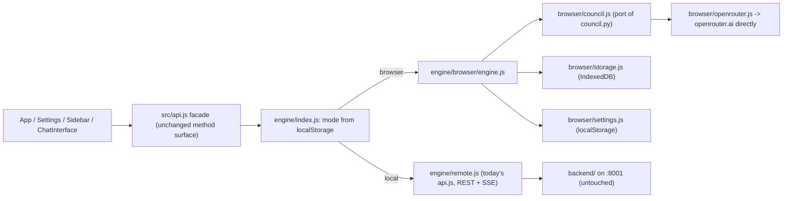

# Serverless Browser Engine

## Architecture

Both engines emit the exact same event stream (`stage1_start`, `stage1_init`, `stage1_model_complete`, ..., `redteam_*`, `stage3_*`, `title_complete`, `complete`, `error`) with the same payload shapes, so `handleStreamEvent` in [frontend/src/App.jsx](frontend/src/App.jsx) and the Stage components are not modified.

## 1. Engine facade and switch

- Move the current contents of [frontend/src/api.js](frontend/src/api.js) to `frontend/src/engine/remote.js`; make `API_BASE` configurable (Settings input, default `http://localhost:8001`, persisted in localStorage).
- `frontend/src/engine/index.js`: `getEngineMode()` / `setEngineMode()` (`'browser'` default, `'local'`), `getEngine()`.
- Rewrite `api.js` as a thin facade with the same methods (`getCredits`, `getPricing`, `getAvailableModels`, `getSettings`, `updateSettings`, `resetSettings`, `listConversations`, `createConversation`, `getConversation`, `removeConversation`, `sendMessageStream`, `retryStage`) delegating to `getEngine()`. Existing imports in components keep working.

## 2. Browser engine (`frontend/src/engine/browser/`)

- `openrouter.js` — port of [backend/openrouter.py](backend/openrouter.py): `catalogueModelId`, `modelFamily`, `resolveMaxTokens` (16000 / 32000), `parseHttpError` (402/404 wording), `hasVisibleContent`, `queryModelResult` (reasoning payload incl. Anthropic `xhigh`, `AbortSignal.timeout(120s)`, 5 attempts with exponential backoff clamped to 60 s since `Retry-After` is not CORS-exposed), `getModelsPricing` (5-min cache), `getCredits`, `getKeyInfo`, `unknownCatalogueIds`. Send `HTTP-Referer: location.origin` and `X-Title`.
- `council.js` — port of [backend/council.py](backend/council.py): file/prompt builders, `composeFollowUpQuery`, `usableStage1Results` / `pendingStage1Slots` / `retainedStage1Failures`, `buildJudgeView` (own-family exclusion with skip-when-empty; deterministic shuffle seeded from SHA-256 of `judge\0query` via `crypto.subtle` — deterministic but not bit-identical to Python's MT shuffle, which is fine because `label_to_index` is stored per result), the four parsers (`parseRankingFromText`, `parseCorrectnessScores`, `parseIssues`, `parseDisputedClaims`) with the same heading regexes, `formatStage2Result`, `calculateAggregateRankings` (normalized Borda over shown set, mean correctness, top-1, merged issues, fallback ordering), `parseRedTeamVerdict`, `pickRedTeamModel`, `redTeamReview`, `familyTop1Agreement`, `computeConsensus` (HIGH gated on a red-team verdict), `buildCouncilMetadata`, `runPostRanking`, `stage3SynthesizeFinal`, `generateConversationTitle`, plus async-generator `stage1CollectResponsesStreaming` / `stage2CollectRankingsStreaming` using an `asCompleted(promises)` helper to mirror `asyncio.as_completed`.
- `storage.js` — IndexedDB (via the small `idb` package) port of [backend/storage.py](backend/storage.py): same conversation JSON schema (`id`, `created_at`, `title`, `messages`, `removed`), same functions including `createStreamingAssistantMessage`, `appendStage1Result/Failure`, `updateStreamingMessage` with the `UNSET` sentinel (omitted = leave alone, `null` = clear), soft delete, UUID validation. Serialize read-modify-write per conversation with a promise-chain lock so the parallel title task cannot clobber Stage 1 appends.
- `settings.js` — localStorage-backed settings with defaults copied from [backend/config.py](backend/config.py) (`COUNCIL_MODELS`, `N_SAMPLES=3`, chairman, `TOP_K=3`, `RED_TEAM_MODEL=null`, `SELF_EXCLUSION=true`, `TITLE_MODEL`), same clamping and `toDict()` shape (`has_api_key`, `masked_api_key`); `reset` keeps the API key.
- `query.js` — port of the request-shaping helpers in [backend/main.py](backend/main.py): `usableFinalAnswer`, `findLatestFollowUpTarget`, `prepareCouncilQuery` (auto follow-up only when no images), `rebuildCouncilQuery` (refuse with the same message when the earlier answer is gone).
- `engine.js` — the engine object. `sendMessageStream` and `retryStage(1|2|3)` run one shared pipeline mirroring `send_message_stream` / `retry_stage*_stream`: title task in parallel, persist every Stage 1 success/failure as it lands, write back the surviving Stage 1 set, clear the stages a retry replaces before running, persist errors with `streaming: false`, settle/cancel the title task in `finally`. `getPricing` returns the same payload as `/api/pricing`; `updateSettings` validates ids against the catalogue and throws with `unknown_models`.

## 3. Settings UI

- New "Engine" section at the top of [frontend/src/components/Settings.jsx](frontend/src/components/Settings.jsx): radio In-browser (serverless) / Local Python backend, backend URL field for local mode. Switching persists the mode and calls a new `onEngineChange` prop; `App.jsx` then reloads the conversation list and resets to a new conversation (the two engines have separate stores).
- API key copy for browser mode: stored only in this browser's localStorage, sent only to openrouter.ai. Local mode is a dev convenience: a deployed https site cannot reach `http://localhost:8001` (mixed content), so the switch is meaningful only when running `npm run dev`.
- Small active-engine indicator in the sidebar header.

## 4. Static deploy

- `vite.config.js`: `base` from `VITE_BASE` (default `/`) and a `test` block for Vitest.
- `.github/workflows/pages.yml`: build `frontend` with `VITE_BASE=/consensus-ai/` and deploy `dist` to GitHub Pages. `dist` also deploys unchanged to Vercel / Netlify / Cloudflare Pages; no rewrites needed (`?c=` routing). `crypto.subtle` needs a secure context, which https hosting and localhost both satisfy.

## 5. Tests and parity with the Python backend

- Add Vitest + `fake-indexeddb` (dev deps), `npm test` script. Port the pytest suites: ranking parsers and Borda cases from [backend/test_ranking.py](backend/test_ranking.py); family / judge-view / resume / consensus-gating from [backend/test_council_integrity.py](backend/test_council_integrity.py); error shaping, max-tokens, visible content, 402 and resume streaming (mocked `fetch`) from [backend/test_openrouter_errors.py](backend/test_openrouter_errors.py); follow-up recomposition, retry clearing and `UNSET` semantics from [backend/test_retry_context.py](backend/test_retry_context.py) / [backend/test_retry_stage3.py](backend/test_retry_stage3.py); catalogue validation from [backend/test_settings_models.py](backend/test_settings_models.py).
- Shared fixtures in `tests/fixtures/` (Stage 2 raw judge texts + expected rankings, scores, consensus level): consumed by a new Vitest parity spec and a new `backend/test_parity_fixtures.py` (pathlib), so the two implementations are checked against the same expectations and drift is caught.

## 6. Docs

- README: "Serverless mode" section (browser engine, where data lives, deploy), engine switch, local mode still documented.
- [CLAUDE.md](CLAUDE.md): frontend engine layout, event-contract parity rule, fixture-based parity tests.

## Known trade-offs (no action needed, stated for review)

- Browser mode requires the tab to stay open during a run; closing it leaves the message `streaming: true`, and the existing Stage 1 retry resumes it (same as a backend crash today).
- Conversations do not move between engines (separate stores). JSON export/import is listed as an optional last step.