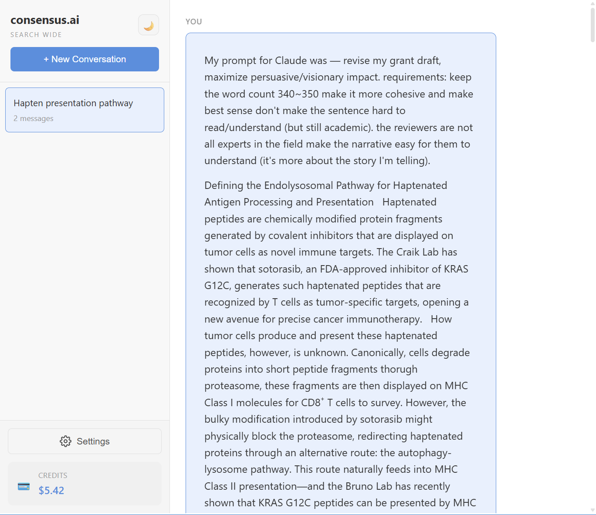
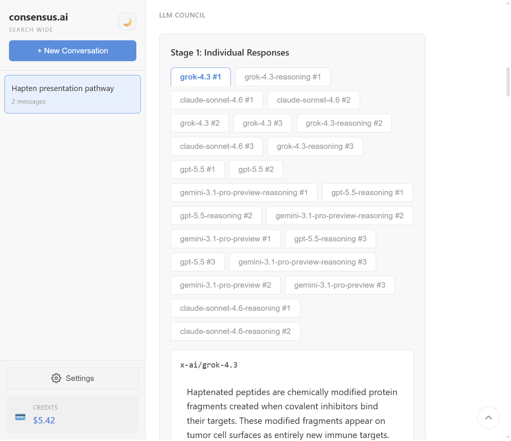
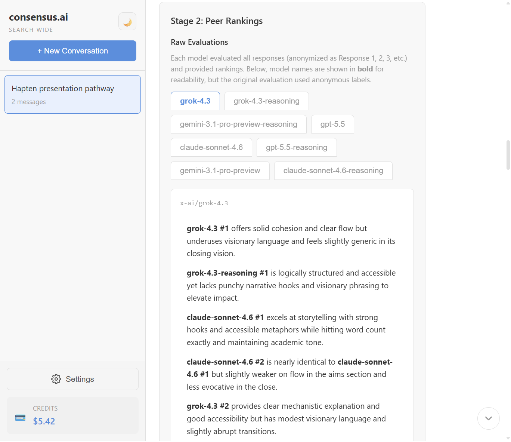
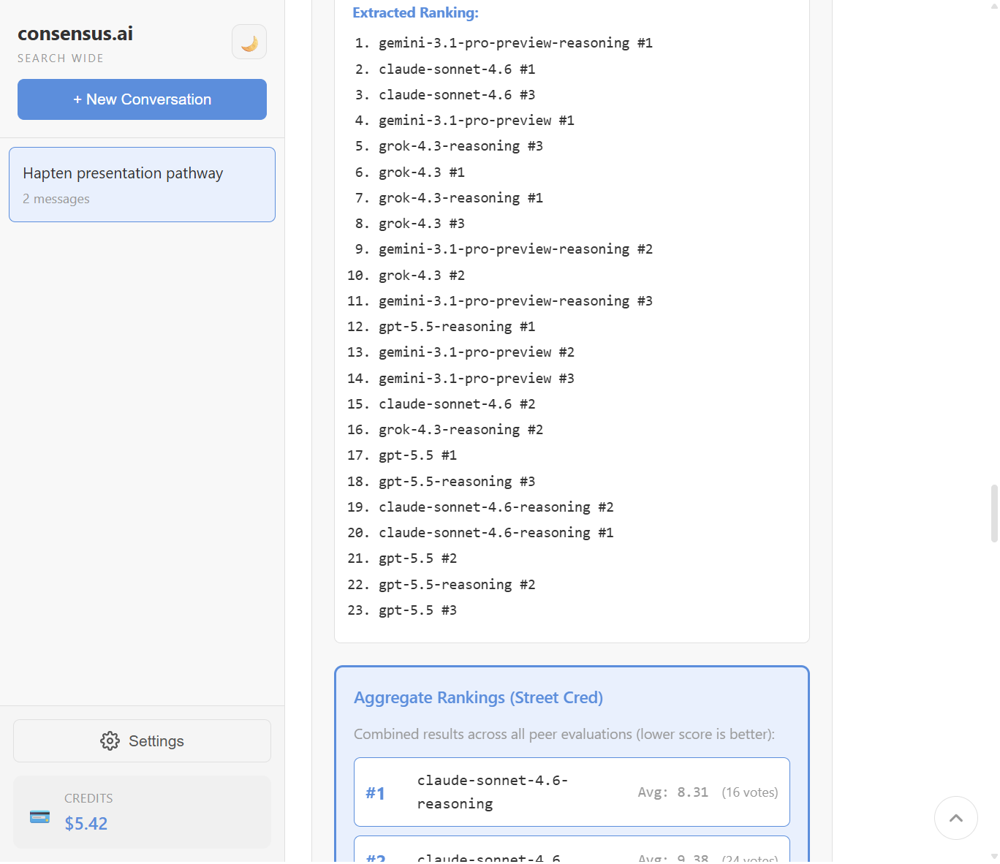
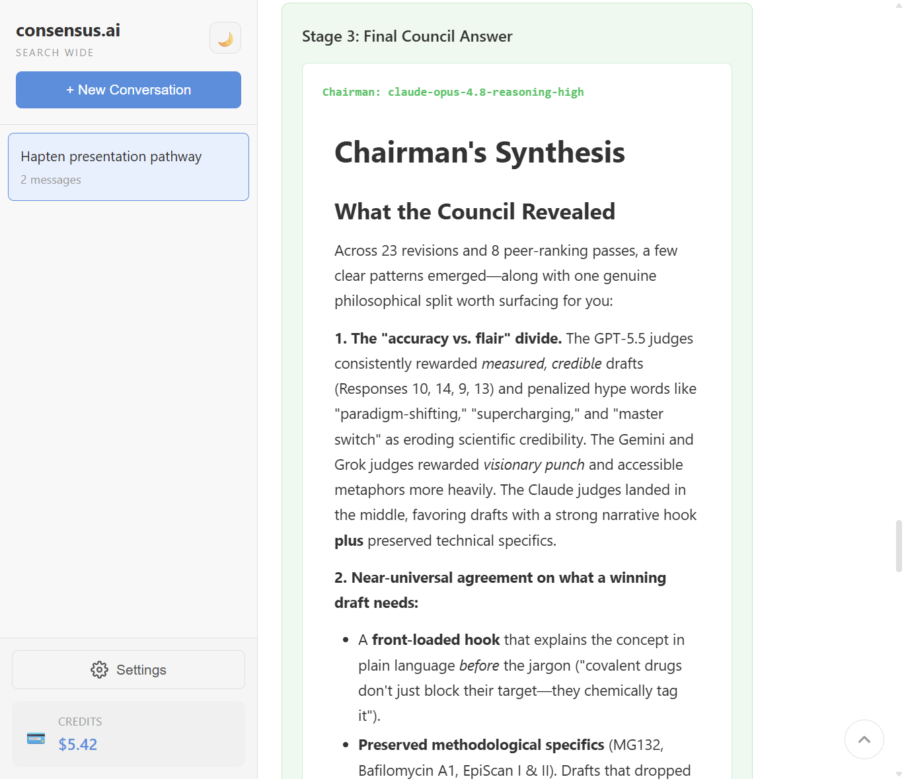
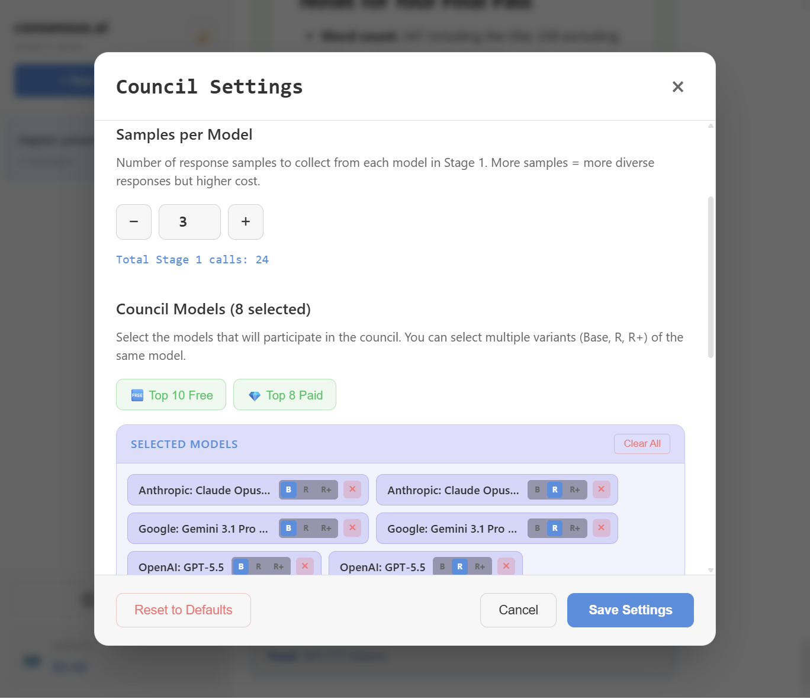
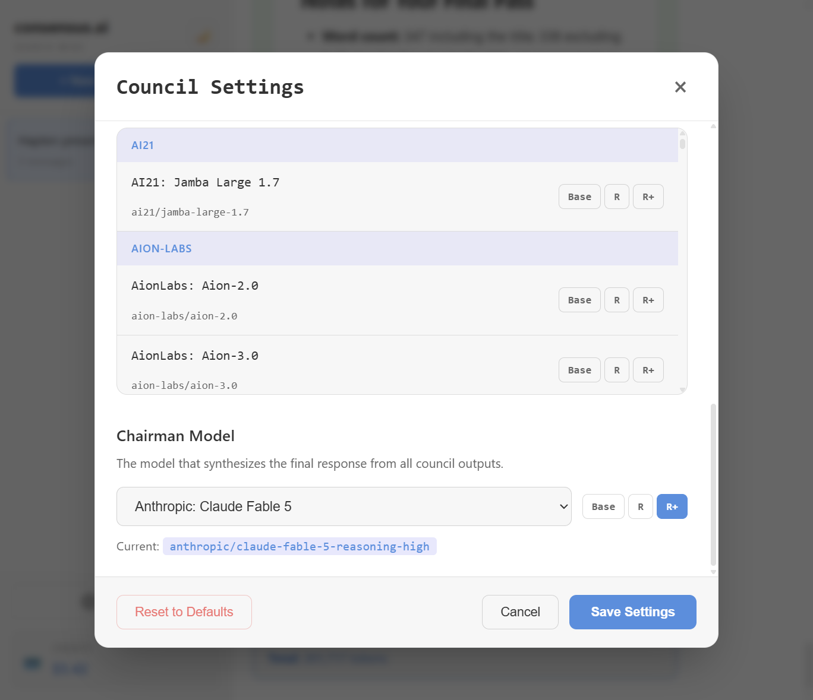
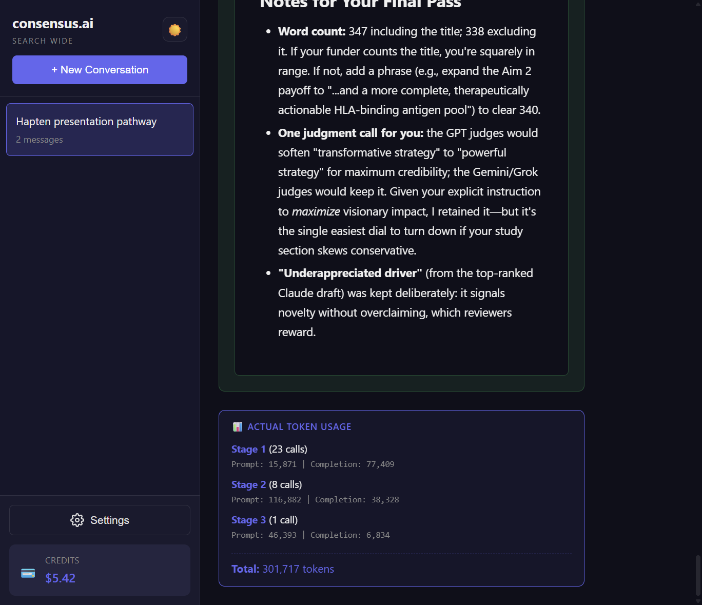

# consensus.ai

**Search Wide** — a local web app where multiple LLMs answer your question, anonymously rank each other's work, and a Chairman model synthesizes the final response.

Fork of [karpathy/llm-council](https://github.com/karpathy/llm-council) with a settings UI, streaming progress, reasoning modes, cost estimates, and OpenRouter credits in the sidebar.

## How it works

1. **Stage 1: First opinions** — Your query goes to every council model in parallel. With `N_SAMPLES > 1`, each model can produce multiple independent answers. Responses appear in a tab view.
2. **Stage 2: Peer review** — Each judge skips every answer from its own vendor, sees a shuffled anonymous list, grades correctness, lists disputed claims, and ranks the rest. Rankings become a Borda score plus a council-confidence level.
3. **Red team** — A reviewer tries to refute the leading answer (`REFUTED` / `CONTESTED` / `UPHELD`). Failure of this pass is non-fatal, but confidence is then capped at `MEDIUM`: peer agreement alone never earns `HIGH`.
4. **Stage 3: Final answer** — The Chairman starts from the top-ranked answer as a base draft, applies corrections from the remaining top-K, and must address disputed claims and the red-team verdict.

## Screenshots

### 1. Ask a question


### 2. Stage 1 — individual model responses


### 3. Stage 2 — raw peer evaluations


### 4. Stage 2 — extracted and aggregate rankings


### 5. Stage 3 — final council answer


### 6. Settings — council models


### 7. Settings — chairman model


### 8. Token usage breakdown


## Features

- **Settings UI** — Pick council models, chairman, samples per model, top-K, self-exclusion, red-team model, and API key without editing code
- **Reasoning modes** — Each model supports **Base**, **R** (medium reasoning), and **R+** (high reasoning) via `-reasoning` / `-reasoning-high` suffixes
- **Quick presets** — Top 10 Free and Top 8 Paid model shortcuts in Settings
- **Streaming** — Live progress during Stage 1–3; resume interrupted runs from where they stopped
- **Cost estimate** — Estimated OpenRouter cost shown before you send (based on council + chairman pricing)
- **Credits display** — OpenRouter balance in the sidebar
- **Attachments** — Paste or attach images and small text files with your prompt
- **Dark mode** — Toggle in the sidebar
- **Serverless** — The council runs in the browser by default, so the built site needs no Python server

## Serverless mode

The default engine calls [openrouter.ai](https://openrouter.ai/) directly from the browser. Conversations live in IndexedDB and settings (including the API key) live in localStorage on that device. Nothing is sent to a backend you host.

```bash
cd frontend
npm install
npm run dev
```

Open **http://localhost:5173**, then set your OpenRouter key in **Settings**. The key stays in this browser's localStorage and is sent only to OpenRouter. localStorage is per origin, so a GitHub Pages project site (`https://<user>.github.io/consensus-ai/`) shares that storage with every other Pages site on the account. **Forget key** in Settings removes it.

**Settings → Engine** switches to the local Python backend (`http://localhost:8001` by default). That mode is for `npm run dev`: a site served over https cannot call `http://localhost`. The two engines keep separate conversations. **Export JSON** / **Import JSON** in Settings moves them.

A production build is a static `frontend/dist` folder (`npm run build`). GitHub Pages builds it with `VITE_BASE=/consensus-ai/` via `.github/workflows/pages.yml`. That host is one origin for the whole account, so the API key and conversations are readable by the account's other Pages sites. The same `dist` deploys to Vercel, Netlify, or Cloudflare Pages at the site root without that prefix, each on its own origin. Routing is `?c=<conversation id>`, so the host does not need SPA rewrites.

Closing the tab mid-run leaves that message marked in progress. Retry Stage 1 resumes samples that already succeeded.

## Sharing a conversation

A finished conversation can be sent as a link. **Share** encrypts it in the browser (compress, then AES-GCM) and uploads only the ciphertext. The key is the `#fragment` of the link, so GitHub Pages, GitHub, and dpaste never receive it or the conversation text.

```text
https://<site>/?share=gist:<id>#<key>
https://<site>/?share=dpaste:<id>#<key>
```

Opening the link shows the conversation read-only, with no OpenRouter key. **Save to my chats** copies it into this browser, or into the local Python backend when that engine is selected. The copy gets a new id.

**GitHub Gist** stores a secret gist. That means unlisted, not private: anyone with the gist id can download the ciphertext, and GitHub shows the account that created it. Settings asks for a fine-grained personal access token with only **Gists: Read and write**. Deleting the gist from the Share dialog removes the file, which makes the link stop working. The browser checks that the gist is actually gone before it drops the link from this device. On a `github.io` project site the token, and every share link saved on this device, live in localStorage for an origin shared with the account's other Pages sites. A saved link includes its decryption key.

**dpaste.com** needs no account. Pick 7, 30, or 365 days. An anonymous paste cannot be deleted before it expires, and the encrypted text must be at most 50,000 characters. If a conversation is too large, share it again without attachments, or use a Gist.

Anyone who has the full link can read the conversation. A link created on `localhost` points at that computer and will not open anywhere else.

## Setup

### 1. Install dependencies

**Backend** (Python 3.10+):

```bash
# Option A: uv
uv sync

# Option B: local venv
python -m venv .venv
.\.venv\Scripts\python.exe -m pip install "fastapi>=0.115.0" "uvicorn[standard]>=0.32.0" "python-dotenv>=1.0.0" "httpx>=0.27.0" "pydantic>=2.9.0"
```

**Frontend:**

```bash
cd frontend
npm install
cd ..
```

### 2. Configure API key

Create a `.env` file in the project root:

```bash
OPENROUTER_API_KEY=sk-or-v1-...
```

Get your key at [openrouter.ai](https://openrouter.ai/). You can also set or update the key in **Settings** at runtime (stored in memory until the backend restarts).

### 3. Configure models (optional)

Defaults live in `backend/config.py`. You can also change everything in the Settings UI without restarting.

```python
COUNCIL_MODELS = [
    "~openai/gpt-sol-latest",
    "~google/gemini-pro-latest",
    "~anthropic/claude-opus-latest",
    "~x-ai/grok-latest",
    "~openai/gpt-sol-latest-reasoning",
    "~google/gemini-pro-latest-reasoning",
    "~anthropic/claude-opus-latest-reasoning",
    "~x-ai/grok-latest-reasoning",
]

N_SAMPLES = 3

CHAIRMAN_MODEL = "~anthropic/claude-fable-latest-reasoning-high"
```

## Running the application

**Terminal 1 — backend** (port **8001**, run from project root):

```bash
# uv
uv run python -m backend.main

# or local venv
.\.venv\Scripts\python.exe -m backend.main
```

**Terminal 2 — frontend** (port **5173**):

```bash
cd frontend
npm run dev
```

Open **http://localhost:5173** in your browser.

On Linux/macOS you can also use `./start.sh` (requires `uv` and `npm` on PATH).

## Does the council beat one model? (free-tier benchmark)

`frontend/eval` runs the real browser engine on questions with an exact answer (AIME 2026, GPQA Diamond, MMLU-Pro) and compares the full council against a single model, majority votes, and one-pass self-aggregation, all on the same questions and the same frozen free-tier roster. Only one personal OpenRouter key is used, every call is journaled, and the roster, prompts, grader, and sample size are frozen before the first test question. Question text never leaves the gitignored `.cache` and `.runs` folders. Setup and commands: [frontend/eval/README.md](frontend/eval/README.md).

The section below is generated by `npm --prefix frontend run eval -- report` and is refreshed every time that command runs. Edits inside the markers are overwritten.

<!-- eval-results:start -->
### Free council vs simpler alternatives: final result on 120 test questions

Generated 2026-10-30T07:21:53.485Z from run `main`, protocol `326c6e10e56e`.
All planned questions are scored. The comparison family and sample size are the ones frozen before the first test call.

Scored so far: AIME 2026 30/30, GPQA Diamond 50/50, MMLU-Pro 40/40. Every arm is graded on the same questions, so the arms are directly comparable.
HTTP POSTs so far (smoke, dev, and test, including retries): 1820. Responses without a usage block: 644 (not counted as zero cost).
28 questions had every Stage 1 call fail at the client network level. Those questions stay in the as-run denominator as failures.

Frozen council (dev-selected): `nvidia/nemotron-3-ultra-550b-a55b:free-reasoning-high`, `dots-studio/dots-3-note-preview:free`, `xingchen-agi/xing4.0-29b-a4b:free`, `poolside/laguna-s-2.1:free`, `google/gemma-4-31b-it:free-reasoning-high`.
Chairman H: `nvidia/nemotron-3-ultra-550b-a55b:free-reasoning-high`. Single-model baseline B: `nvidia/nemotron-3-ultra-550b-a55b:free-reasoning-high`. H = B, so A0 reuses the A1 call and is not a separate comparison.

#### As run on free endpoints (operational, pre-registered)

| Arm | What it is | Calls per question | Pooled | Macro (mean of blocks) | AIME | GPQA | MMLU-Pro |
| --- | --- | --- | --- | --- | --- | --- | --- |
| A0 | Chairman model H answers the question directly (same call as A1 here) | 1 | 53.3% | 53.6% | 43.3% | 40.0% | 77.5% |
| A1 | Single dev-selected model B, one sample | 1 | 53.3% | 53.6% | 43.3% | 40.0% | 77.5% |
| A2 | Plurality vote over five samples of B | 5 | 63.3% | 63.4% | 53.3% | 52.0% | 85.0% |
| A3 | One-pass Self-MoA: H aggregates five samples of B | 6 | 61.7% | 61.1% | 46.7% | 54.0% | 82.5% |
| A4 | Plurality vote over the five council Stage 1 answers | 5 | 58.3% | 58.8% | 50.0% | 44.0% | 82.5% |
| A5 | Stage 2 leader: top-ranked council answer, no rewrite | 10 | 54.2% | 53.1% | 33.3% | 46.0% | 80.0% |
| A6 | Full council: Stage 1, Stage 2, red team, chairman H | 12 | 64.2% | 65.1% | 63.3% | 52.0% | 80.0% |
| A7 | Council without red team: Stage 1, Stage 2, chairman H | 11 | 68.3% | 69.1% | 66.7% | 58.0% | 82.5% |

Pooled = share of correct final answers over all scored questions. Macro = unweighted mean of the three block accuracies. Calls per question = nominal standalone cost of that arm with no retries.

#### Primary family: A6 (full council) vs alternatives, paired on the same questions (m = 4)

| Comparison | Δ pp (A6 − alt) | Wins / losses / ties | Exact McNemar p | Holm p | 95% paired bootstrap CI (pp) | Bonferroni CI (pp) | Reading at δmin = 5 pp |
| --- | --- | --- | --- | --- | --- | --- | --- |
| A6 − A1 | +10.8 | 21 / 8 / 91 | 0.024 | 0.096 | [+2.5, +19.2] | [0.0, +21.7] | Insufficient evidence either way |
| A6 − A2 | +0.8 | 10 / 9 / 101 | 1.000 | 1.000 | [−6.7, +7.5] | [−8.3, +10.0] | Insufficient evidence either way |
| A6 − A3 | +2.5 | 13 / 10 / 97 | 0.678 | 1.000 | [−5.0, +10.0] | [−7.5, +12.5] | Insufficient evidence either way |
| A6 − A4 | +5.8 | 15 / 8 / 97 | 0.210 | 0.630 | [−1.7, +13.3] | [−4.2, +15.8] | Insufficient evidence either way |

"Better than every alternative by more than 5 pp" is not supported.
Wins = questions where A6 is correct and the alternative is wrong. McNemar tests the null of zero difference; the interval answers whether a 5 pp gain is supported or excluded. "Insufficient evidence" is not evidence of equivalence.

#### Stage diagnostics (exploratory, no family correction)

| Comparison | Meaning | Δ pp | Wins / losses / ties | Exact McNemar p | 95% CI (pp) |
| --- | --- | --- | --- | --- | --- |
| A5 − A4 | Stage 2 ranking vs plurality over the same five answers | −4.2 | 2 / 7 / 111 | 0.180 | [−9.2, 0.0] |
| A7 − A5 | Chairman rewrite without red team vs the leader it starts from | +14.2 | 21 / 4 / 95 | <0.001 | [+6.7, +21.7] |
| A6 − A7 | Red team effect through the whole pipeline | −4.2 | 3 / 8 / 109 | 0.227 | [−9.2, +0.8] |
| A6 − A5 | Chairman plus red team vs the leader | +10.0 | 20 / 8 / 92 | 0.036 | [+1.7, +18.3] |

#### Failure modes per arm (counts over scored questions)

| Arm | Correct | Wrong answer | Parse error | Refusal | No answer | Not run | Transport failure | Chairman fallback |
| --- | --- | --- | --- | --- | --- | --- | --- | --- |
| A0 | 64 | 2 | 2 | 0 | 0 | 0 | 52 |  |
| A1 | 64 | 2 | 2 | 0 | 0 | 0 | 52 |  |
| A2 | 76 | 1 | 0 | 0 | 43 | 0 | 0 |  |
| A3 | 74 | 1 | 0 | 0 | 42 | 0 | 3 |  |
| A4 | 70 | 9 | 0 | 0 | 41 | 0 | 0 |  |
| A5 | 65 | 7 | 19 | 0 | 0 | 29 | 0 |  |
| A6 | 77 | 6 | 3 | 0 | 0 | 29 | 5 | 0 |
| A7 | 82 | 3 | 0 | 0 | 0 | 29 | 6 | 0 |

Every failure scores 0 and stays in the denominator. Transport failure = timeout, truncated stream, provider error, or a skipped call. Ranking fallback (no parseable Stage 2 ranking, Stage 1 order used): 30 of 120.

#### Council confidence label (computed about the Stage 2 leader before synthesis)

| Label | n | Coverage | Leader (A5) accuracy | 95% Wilson | A6 accuracy under this label | Validated (n ≥ 5) |
| --- | --- | --- | --- | --- | --- | --- |
| HIGH | 15 | 12.5% | 86.7% | [62.1%, 96.3%] | 93.3% | yes |
| MEDIUM | 48 | 40.0% | 77.1% | [63.5%, 86.7%] | 93.8% | yes |
| LOW | 12 | 10.0% | 66.7% | [39.1%, 86.2%] | 75.0% | yes |
| CONTESTED | 16 | 13.3% | 43.8% | [23.1%, 66.8%] | 56.3% | yes |

Questions without a label: 29. This checks whether the labels carry information; it is not probability calibration.
Red team: REFUTED n=16, P(leader wrong | REFUTED) = 56.3%; UPHELD n=52, P(leader wrong | UPHELD) = 15.4%, P(UPHELD | leader wrong) = 14.5% over 55 wrong leaders; CONTESTED n=10; missing or unparsed 42. A correct final answer does not verify the red-team argument.

Selection: P(A5 correct | some council answer correct) = 86.7% over 75; P(A4 correct | same) = 93.3%. A6 produced a correct answer that no council member had 11 times, A7 11 times.


#### Transport failures retried via paid endpoints (secondary, exploratory)

Re-scored 120 of 120 questions that already have an as-run result. 0 of those are not repaired yet. Transport failures were re-executed after the as-run data were inspected. Paid endpoints, where the catalogue has them, are separate deployments of the same weights. This layer is secondary and exploratory; the pre-registered as-run result is unchanged.
Slots reused from the free run: 552. Slots executed again: 1608 (paid posts 1245, free posts 206).
Spend on the paid key (OpenRouter key usage counter): $21.1509. Local estimate used for the cap: $21.5088; calls with unknown usage are charged there at max_tokens × completion price (62 calls).
Paid stand-ins: `nvidia/nemotron-3-ultra-550b-a55b:free-reasoning-high` → `nvidia/nemotron-3-ultra-550b-a55b-reasoning-high`; `poolside/laguna-s-2.1:free` → `poolside/laguna-s-2.1`; `google/gemma-4-31b-it:free-reasoning-high` → `google/gemma-4-31b-it-reasoning-high`.

| Arm | Calls per question | Pooled | Macro | AIME | GPQA | MMLU-Pro |
| --- | --- | --- | --- | --- | --- | --- |
| A0 | 1 | 80.8% | 81.1% | 76.7% | 74.0% | 92.5% |
| A1 | 1 | 80.8% | 81.1% | 76.7% | 74.0% | 92.5% |
| A2 | 5 | 90.8% | 91.2% | 90.0% | 86.0% | 97.5% |
| A3 | 6 | 91.7% | 92.6% | 96.7% | 86.0% | 95.0% |
| A4 | 5 | 85.8% | 86.7% | 90.0% | 80.0% | 90.0% |
| A5 | 10 | 78.3% | 78.3% | 73.3% | 74.0% | 87.5% |
| A6 | 12 | 87.5% | 88.9% | 96.7% | 80.0% | 90.0% |
| A7 | 11 | 90.8% | 91.7% | 96.7% | 86.0% | 92.5% |

| Comparison | Δ pp (A6 − alt) | Wins / losses / ties | Holm p | Bonferroni CI (pp) | Reading at δmin = 5 pp |
| --- | --- | --- | --- | --- | --- |
| A6 − A1 | +6.7 | 11 / 3 / 106 | 0.229 | [0.0, +14.2] | Insufficient evidence either way |
| A6 − A2 | −3.3 | 4 / 8 / 108 | 0.775 | [−10.8, +3.3] | Useful gain excluded: upper bound below 5 pp |
| A6 − A3 | −4.2 | 3 / 8 / 109 | 0.680 | [−11.7, +2.5] | Useful gain excluded: upper bound below 5 pp |
| A6 − A4 | +1.7 | 6 / 4 / 110 | 0.775 | [−5.0, +8.3] | Insufficient evidence either way |

#### Re-executed slots and residual failures

| Arm | Correct | Wrong answer | Parse error | No answer | Not run | Transport failure |
| --- | --- | --- | --- | --- | --- | --- |
| A0 | 97 | 6 | 16 | 0 | 0 | 1 |
| A1 | 97 | 6 | 16 | 0 | 0 | 1 |
| A2 | 109 | 5 | 0 | 6 | 0 | 0 |
| A3 | 110 | 9 | 1 | 0 | 0 | 0 |
| A4 | 103 | 17 | 0 | 0 | 0 | 0 |
| A5 | 94 | 13 | 13 | 0 | 0 | 0 |
| A6 | 105 | 8 | 6 | 0 | 0 | 0 |
| A7 | 109 | 10 | 1 | 0 | 0 | 0 |

Paid endpoints are other deployments of the same weights, not a different model choice. The decision to retry was made after seeing the as-run data, so this layer is not the pre-registered comparison. A residual transport failure still scores 0.

This table is a measurement, not a product decision. It does not change Stage 2 or the UI. Numbers refresh with `npm --prefix frontend run eval -- report`.
<!-- eval-results:end -->

## Tech stack

- **Backend:** FastAPI, async httpx, OpenRouter API (port 8001)
- **Frontend:** React + Vite, react-markdown + GFM tables
- **Storage:** IndexedDB in the browser, or JSON files in `data/conversations/` when the local Python backend is selected
- **Package management:** uv or pip + `.venv` for Python, npm for JavaScript

## Credits

Based on [LLM Council](https://github.com/karpathy/llm-council) by Andrej Karpathy.
